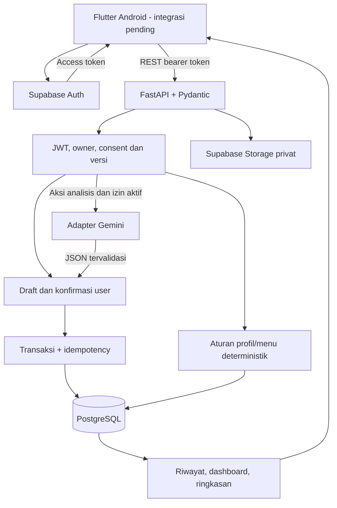

# AIBS

Pendamping pemilihan menu dan pencatatan makanan/gejala untuk orang dewasa dengan IBS, mengikuti arahan makan yang dilaporkan pengguna.

**LOGICODIX 2026 · Mobile Android · Inclusive Health & Well-being**

**Status:** source backend sudah diimplementasikan bertahap dan diuji otomatis. Flutter/APK, deployment HTTPS, Auth/Storage Supabase nyata dan model Gemini nyata **belum diverifikasi**. Katalog, profil demo, dan aturan pengecekan merupakan data/aturan sintetis, bukan diagnosis atau jaminan keamanan makanan.

- [Setup backend](backend/README.md)
- [Status tahap, branch, dan PR](docs/backend-progress.md)
- [Kontrak API dan OpenAPI](docs/api/README.md)
- [Roadmap commit](docs/backend-workflow.md)
- [Rancangan awal](docs/backend-design.md) dan [pemetaan sumber/gap desain](docs/backend-requirements.md)
- [Release dan pemeriksaan yang masih pending](docs/backend-release.md)
- [Flutter frontend](frontend/README.md) · [Design handoff](frontend/docs/design/DESIGN.md)

## Identitas tim dan akses penilaian

| Informasi | Nilai |
| --- | --- |
| Aplikasi / tim | AIBS / udah beli tiket buat final sejak 6 nov |
| Ketua tim | [ISI: nama sesuai pendaftaran] |
| Repository | [danariqbalabi/AIBS](https://github.com/danariqbalabi/AIBS), publik saat verifikasi API GitHub |
| Backend source version | 0.1.0; belum merupakan release submission |
| Backend demo HTTPS | [ISI: deployment aktif yang sudah diuji] |
| APK | [ISI: tautan APK yang dapat dipasang juri] |
| Video | [ISI: YouTube Public/Unlisted, 3–5 menit] |
| Commit final submission | [ISI: hash yang sama dengan backend, APK dan video] |

| Anggota | Identitas / peran | Tanggung jawab |
| --- | --- | --- |
| Danar | Danar Iqbal Abi / [danariqbalabi](https://github.com/danariqbalabi) — Backend | API, aturan, DB, ownership, penyimpanan, dashboard, adapter, README dan backend release |
| Kwien | Amanda Kwienisa — Frontend | Flutter, Auth client, kamera, editor, navigasi, integrasi dan APK |
| Razan | Razan Muhammad — UI/UX | Flow, komponen, copy dan state |
| Micguel | Micguel Katili — AI | Review prompt/schema, evaluasi model foto/jurnal, kualitas dan token usage |

Nama mengikuti README awal tim; akun anggota lain dan ketua perlu dilengkapi sesuai pendaftaran. Identitas Git tidak membuktikan status peserta terdaftar.

## Masalah, target dan solusi

Pengguna perlu mempertimbangkan bahan, porsi, alergi, budget dan arahan klinisi ketika memilih makanan. Komposisi saus/bumbu sering belum diketahui; makanan dan gejala setelahnya perlu dicatat dengan waktu berbeda.

Target rancangan adalah orang dewasa yang melaporkan diagnosis IBS dan arahan makan dari dokter/ahli gizi. Pengguna tanpa konteks tersebut mendapat jalur pencatatan dan ringkasan konsultasi. Hasil pola demo tidak menetapkan diagnosis atau otomatis memberi akses diet.

Alur: **profil -> pilih menu -> foto/isi manual -> konfirmasi bahan dan porsi -> catat sudah dimakan/gejala -> riwayat dan Hari Ini**. AI hanya membantu membuat draft. Manual tetap tersedia ketika AI mati/gagal/kuota habis.

## Fitur dan status implementasi

Tabel ini menyatakan cakupan **backend**, bukan Android sudah selesai. Bukti lokal/CI memakai data sintetis dan mock untuk provider eksternal.

| Fitur | Backend tersedia | Verifikasi tambahan |
| --- | --- | --- |
| Auth/demo | JWT asymmetric, demo namespace per subject | OTP/anonymous Supabase nyata dan client |
| Profil/izin | Izin dasar/AI terpisah, diet berversi, autosave jawaban | Review flow/copy dengan FE/UX |
| Pengecekan awal | Routing dan `rome_v_c1_demo`, unknown terpisah | Klinisi/izin instrumen untuk penggunaan di luar demo |
| Menu/cek makanan | Filter/detail, konflik alergi/bahan/porsi, ranking deterministik | Kurasi klinis, komposisi dan harga nyata |
| Rencana/belanja | CRUD terpisah dari konsumsi; merge bahan+satuan sama | Integrasi UI |
| Draft/manual | CRUD, story, review versi dan discard | Editor Flutter |
| Foto/jurnal AI | Adapter JSON schema, consent/quota/fallback | Key/model, provider live, evaluasi Miguel |
| Media | Gambar tervalidasi, path owner, signed URL privat | Key/bucket dan smoke Storage nyata |
| Penyimpanan | Transaksi, idempotency, satu commit per draft | Smoke Flutter/jaringan |
| Gejala/BAB | Event terpisah, negasi, waktu, severity/Bristol, tautan batch | Penyelarasan skala/editor |
| Riwayat | Filter/cursor, detail/edit/hapus, ownership | Integrasi refresh UI |
| Dashboard/ringkasan | Event tersimpan, 7/30 hari, evidence/keterbatasan | Tampilan dan demo aplikasi |

OCR, merchant, ekspor, suara, pengingat, hapus akun menyeluruh dan retensi foto otomatis belum tersedia. Tombol pada hi-fi bukan bukti implementasi.

## Arsitektur dan alur data



Frontend memakai Auth untuk sesi dan FastAPI untuk data fitur. SQLAlchemy/psycopg mengakses DB langsung; Alembic mengelola migrasi. RLS menutup akses client pada tabel AIBS; role server tetap wajib memfilter owner.

Draft, rencana dan belanja tidak masuk hitungan konsumsi. Konfirmasi menyimpan makanan dan gejala terpisah dengan snapshot evaluasi. Idempotency key melindungi retry/klik ganda. Edit/hapus tercermin pada query berikutnya; FE harus refresh data terkait.

Waktu pasti menyimpan offset, waktu perkiraan mempertahankan periodenya. Dashboard memakai timezone profil dan tidak menghitung negasi sebagai keluhan hadir. Hubungan makan/gejala adalah tautan/urutan, bukan sebab-akibat.

## Teknologi dan struktur repository

Runtime lokal: Python 3.13.15; project mendukung 3.12/3.13. Versi lengkap ada pada [pyproject.toml](backend/pyproject.toml) dan [uv.lock](backend/uv.lock).

| Bagian | Versi lock |
| --- | --- |
| FastAPI / Uvicorn | 0.162.2 / 0.54.0 |
| Pydantic / Settings | 2.14.3 / 2.16.2 |
| SQLAlchemy / Alembic | 2.1.8 / 1.20.1 |
| psycopg / PyJWT | 3.3.8 / 2.15.1 |
| HTTPX / Pillow | 0.28.1 / 12.3.0 |
| pytest / Ruff | 9.2.0 / 0.17.4 |
| uv lokal | 0.13.7 |

```text
backend/
  app/           # routes, schema, services, rules, models, adapters
  alembic/       # migrasi versioned
  seeds/         # katalog sintetis repeatable
  tests/         # unit/integrasi/provider HTTP mock
  .env.example
  pyproject.toml
  uv.lock
frontend/
  lib/           # aplikasi Flutter dan layar utama AIBS
  assets/maskot/ # ilustrasi koala AIBS
  test/          # widget tests
docs/            # kontrak, fixture, desain, workflow dan verifikasi
.github/workflows/backend.yml
```

Frontend Flutter tersedia di `frontend/` sebagai prototipe interaktif: onboarding, Hari Ini/Profil, Menu, cek makanan, dan Jurnal. Integrasi API, autentikasi, kamera perangkat, serta penyimpanan persisten masih dikerjakan.

## Instalasi dan menjalankan

```powershell
git clone https://github.com/danariqbalabi/AIBS.git
Set-Location AIBS
git switch docs/backend-release
Set-Location backend
uv sync --locked
Copy-Item .env.example .env
```

Saat PR belum di-merge, gunakan branch di atas. Setelah integrasi tim, checkout hash yang akan dinilai. Jika `.env` sudah ada, pertahankan dan edit nilainya. Isi `DATABASE_URL` dan `SUPABASE_URL`, lalu:

```powershell
uv run alembic upgrade head
uv run python -m seeds.catalog
uv run alembic check
uv run uvicorn app.main:create_app --factory --reload --host 0.0.0.0 --port 8000
```

`/health` memeriksa proses; `/ready` DB; `/docs` dan `/openapi.json` menjelaskan endpoint tersedia. Environment/base URL emulator ada di [backend README](backend/README.md). Manual tidak membutuhkan key AI tetapi akun tetap membutuhkan token Auth valid.

Foto memerlukan service-role key server dan bucket privat: [panduan media](docs/media.md). AI memerlukan key/model tersedia: [panduan AI](docs/ai-integration.md). Semua secret di `.env` yang diabaikan Git; env example hanya nama/default non-rahasia.

Untuk menjalankan frontend:

```powershell
Set-Location frontend
flutter pub get
flutter run
```

Verifikasi UI dengan `flutter analyze` dan `flutter test` dari folder `frontend`. Data frontend masih contoh/in-memory; autentikasi, kamera perangkat, dan penyimpanan belum dihubungkan ke backend.

## Demo dan verifikasi

Client membuat anonymous Supabase Auth session khusus demo, memilih Nadia (alergi udang/budget Rp25rb) atau Raka (alergi kacang tanah/budget Rp35rb), lalu POST `/api/v1/demo/sessions`. Tiap subject mendapat profil privat. AI default off sampai persetujuan eksplisit. Reset dengan sesi baru; tidak memakai akun/password writable bersama. [Detail Auth](docs/auth.md).

Alur backend yang diuji: profil/consent -> assessment/diet -> katalog -> draft manual -> review -> commit -> riwayat/dashboard -> edit/hapus dan query ulang. Analisis foto/jurnal memakai editor draft sama. Aktivasi demo di Supabase dan pengujian APK masih pending; akses juri final jangan bergantung pada OTP anggota tim.

```powershell
uv run ruff check .
uv run ruff format --check .
uv run pytest
```

Tahap 15 lokal: **71 passed, 2 skipped**. [CI tahap pengujian](https://github.com/danariqbalabi/AIBS/actions/runs/42751323377) lulus dengan PostgreSQL disposable dan matrix Python 3.12/3.13; dua tes PostgreSQL-only yang skip lokal dijalankan di CI. Mencakup rollback setelah insert, concurrency, ownership, consent, quota, input invalid, waktu/negasi dan perubahan dashboard.

Smoke provider nyata, kualitas model, autentikasi Flutter, APK, deployment publik dan video belum dibuktikan. Pemeriksaan clone bersih dan langkah rilis ada di [panduan release](docs/backend-release.md).

## AI, sumber, atribusi dan batasan

AI produk: adapter Gemini untuk `photo_to_draft`/`journal_to_draft`, prompt `reviewed_draft_v1`; model final belum dipilih/diverifikasi. Aturan/menu/akses/ownership/simpan/dashboard tidak memakai model. Log tidak menyimpan isi jurnal/foto; metrik berisi status/model/prompt/hash/token/latency. Review/edit/simpan tidak memanggil AI.

OpenAI Codex dipakai sebagai AI coding assistant untuk analisis dokumen, dokumentasi, implementasi backend, tes dan Git/PR. Tim wajib meninjau dan mampu menjelaskan kode. Tidak memakai proyek jadi/template aplikasi lengkap.

Katalog buatan tim adalah sintetis, bukan dataset nutrisi/pasien. Harga/komposisi/tag hanya demo. `rome_v_c1_demo` merupakan adaptasi PRD, bukan instrumen resmi atau diagnosis. Izin instrumen dan review klinisi/copy diperlukan sebelum penggunaan pada pasien. Efektivitas klinis belum diuji.

Sumber kebutuhan: PRD, guidebook, hi-fi dan design system dari pengguna; [pemetaan halaman/frame/gap](docs/backend-requirements.md). Sumber tidak diunggah ke repo. Nunito/koala pada handoff belum disalin ke backend; atribusi aset mobile dilengkapi saat dipakai.

Teknologi pihak ketiga: [FastAPI](https://fastapi.tiangolo.com/), [Pydantic](https://docs.pydantic.dev/), [SQLAlchemy](https://www.sqlalchemy.org/), [Alembic](https://alembic.sqlalchemy.org/), [psycopg](https://www.psycopg.org/), [PyJWT](https://pyjwt.readthedocs.io/), [HTTPX](https://www.python-httpx.org/), [Pillow](https://python-pillow.github.io/), [uv](https://docs.astral.sh/uv/), [Supabase](https://supabase.com/docs), [Gemini](https://ai.google.dev/gemini-api/docs), [pytest](https://docs.pytest.org/), [Ruff](https://docs.astral.sh/ruff/). Versi transitive di lockfile; pertahankan notice/lisensi distribusi. Lisensi kode tim masih perlu ditetapkan.

## Checklist submission

- [x] Source backend, migrasi/seed, env example, kontrak, tes dan CI di branch bertahap.
- [x] Repo publik dan hak push/PR diverifikasi saat pengerjaan.
- [ ] Review/merge PR berurutan tanpa menulis ulang riwayat yang dipublikasikan.
- [ ] Isi konfigurasi server; smoke Supabase DB/Auth/Storage dan Gemini nyata.
- [ ] Lengkapi layar Flutter, integrasi backend, APK dan akses demo juri.
- [ ] Kurasi data/copy, evaluasi AI, kebijakan retensi/pemrosesan data final.
- [ ] Smoke dari commit final, deploy HTTPS dan jaga kuota selama penilaian.
- [ ] Video aplikasi berjalan 3–5 menit; URL dan hash APK/backend konsisten.
- [ ] Identitas/ketua, atribusi, surat orisinalitas dan hash final terisi.
- [ ] Submission sebelum **14 November 2026 pukul 23.59 WIB** menurut guidebook yang diberikan; jam portal/konfirmasi resmi panitia menjadi acuan. Freeze fitur internal PRD tanggal 12.

PR dan tes saat ini bukan release submission. Setelah freeze, ikuti ketentuan guidebook tentang kode, deployment dan riwayat commit.
