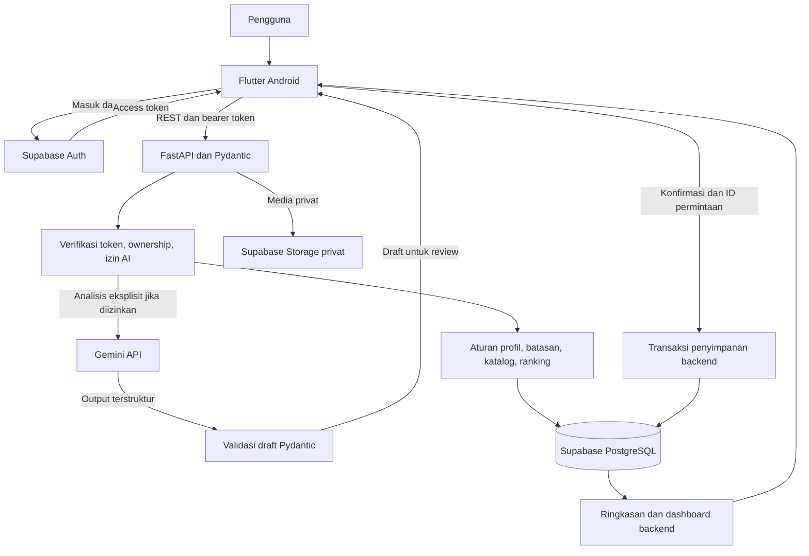

# AIBS

Pendamping pemilihan menu dan pencatatan makanan serta gejala untuk orang dewasa dengan Irritable Bowel Syndrome (IBS).

**LOGICODIX 2026 · Kategori Mobile (Android) · Subtema Inclusive Health & Well-being**

> **Status dokumen:** disusun dari `GUIDEBOOK-LOGICODIX-FINAL.pdf` dan `PRD Logicodix.pdf`. Pada penyusunan awal, direktori proyek belum memuat source code, konfigurasi, atau build aplikasi. Fitur di bawah merupakan cakupan MVP dalam PRD, belum merupakan klaim implementasi. Penanda `[ISI: ...]` harus diganti dengan data nyata dan petunjuk teknis harus diselaraskan dengan commit final sebelum submission.

## Daftar isi

- [Identitas tim dan akses penilaian](#identitas-tim-dan-akses-penilaian)
- [Masalah dan target pengguna](#masalah-dan-target-pengguna)
- [Solusi dan nilai utama](#solusi-dan-nilai-utama)
- [Fitur utama dan status implementasi](#fitur-utama-dan-status-implementasi)
- [Alur penggunaan](#alur-penggunaan)
- [Arsitektur sistem dan alur data](#arsitektur-sistem-dan-alur-data)
- [Teknologi dan struktur repository](#teknologi-dan-struktur-repository)
- [Instalasi, konfigurasi, dan menjalankan aplikasi](#instalasi-konfigurasi-dan-menjalankan-aplikasi)
- [Dokumentasi penggunaan AI](#dokumentasi-penggunaan-ai)
- [Aturan produk, privasi, dan batasan](#aturan-produk-privasi-dan-batasan)
- [Skenario demo dan verifikasi](#skenario-demo-dan-verifikasi)
- [Rencana pengerjaan](#rencana-pengerjaan)
- [Atribusi dan referensi](#atribusi-dan-referensi)
- [Checklist submission](#checklist-submission)

## Identitas tim dan akses penilaian

| Informasi | Nilai |
| --- | --- |
| Nama aplikasi | AIBS |
| Nama tim | udah beli tiket buat final sejak 6 nov |
| Ketua tim | [ISI: nama lengkap ketua] |
| Kategori | Mobile, target Android |
| Subtema | Inclusive Health & Well-being |
| Repository publik | [ISI: URL GitHub] |
| APK/distribusi Android | [ISI: tautan unduhan yang dapat diakses juri] |
| Video demo | [ISI: URL YouTube Public/Unlisted, durasi 3–5 menit] |
| Versi release | [ISI: versi/tag release] |
| Commit final | [ISI: hash commit final yang sama dengan APK, backend, dan rekaman demo] |
| Backend demo | [ISI: base URL backend aktif] |
| Akses demonstrasi | [ISI: langkah masuk akun demo atau Coba Demo yang telah diuji] |

Nama produk, nama tim, dan nama lengkap anggota mengikuti informasi dari tim. Pembagian peran mengikuti PRD; akun GitHub, ketua tim, serta akses rilis akan dilengkapi menyusul.

| Anggota | Nama lengkap / GitHub | Peran | Tanggung jawab |
| --- | --- | --- | --- |
| Danar | Danar Iqbal Abi / [ISI: akun GitHub] | Backend | API, profil, katalog, aturan batasan, penyimpanan, ownership, dashboard, migrasi, seed demo, README, release |
| Kwien | Amanda Kwienisa / [ISI: akun GitHub] | Frontend | Flutter Android, navigasi, profil, menu, kamera, editor draft, jurnal, Hari Ini |
| Razan | Razan Muhammad / [ISI: akun GitHub] | UI/UX | Flow Figma, komponen, microcopy, state kosong, loading, konfirmasi, gagal, tersimpan |
| Micguel | Micguel Katili / [ISI: akun GitHub] | AI | Pipeline foto dan jurnal, prompt, schema JSON, fixture, evaluasi, penggunaan token, fallback |

### Akun demonstrasi

PRD merencanakan tombol **Coba Demo** dengan dua profil sintetis dan sesi yang terpisah dari akun biasa. Jalur ini belum diverifikasi pada build.

- Cara mengakses: [ISI: langkah dari layar awal sampai profil demo].
- Jika autentikasi diperlukan: [ISI: identitas akun demo dan mekanisme akses yang dapat digunakan juri tanpa izin tambahan atau bergantung pada OTP milik anggota tim].
- Reset data demo: [ISI: cara mengembalikan seed untuk mengulang demo].
- Persyaratan perangkat: [ISI: minimum Android, kebutuhan jaringan, dan izin kamera/galeri sesuai build final].

Gunakan akun serta data khusus demonstrasi. Jangan menaruh kredensial produksi, API key, atau service-role key di README.

## Masalah dan target pengguna

Orang dewasa dengan IBS perlu mempertimbangkan bahan, porsi, arahan diet, dan pengalaman pribadi saat memilih makanan. Saat membeli makanan di luar, komposisi saus atau bumbu sering belum diketahui. Gejala yang muncul beberapa jam kemudian juga sulit dicatat secara runtut jika pengguna harus mengingat waktu makan dan awal keluhan.

Target utama adalah pengguna berusia 18 tahun ke atas yang melaporkan diagnosis IBS dari dokter dan memiliki arahan makan dari dokter atau ahli gizi. Pengguna tanpa diagnosis atau arahan diet yang sesuai diarahkan ke pencatatan dan ringkasan untuk konsultasi.

Contoh kebutuhan dalam PRD: mahasiswa dengan budget Rp25.000 per porsi ingin mengecek makanan sebelum makan, mengonfirmasi saus yang tidak diketahui dari foto, lalu mencatat makanan dan gejala dengan waktu yang terpisah.

PRD menggunakan studi prevalensi IBS, laporan hubungan makanan dan gejala, intervensi diet, reintroduksi, serta jurnal FAST sebagai dasar masalah dan rancangan pencatatan. Daftar sumber ada pada [Atribusi dan referensi](#atribusi-dan-referensi). Temuan studi tersebut bukan bukti efektivitas klinis AIBS.

## Solusi dan nilai utama

AIBS menghubungkan profil, katalog menu terkurasi, pemeriksaan bahan, dan jurnal dalam satu alur:

**Isi profil → pilih menu → foto makanan → konfirmasi bahan → simpan makanan/gejala → lihat riwayat dan Hari Ini.**

Nilai utama rancangan:

1. Alergi dan arahan klinisi diperiksa sebelum kandidat menu diurutkan berdasarkan budget serta preferensi.
2. Foto menghasilkan draft yang bisa dikoreksi. Saus, bumbu, atau porsi yang tidak jelas tetap meminta konfirmasi.
3. Cerita bebas dirapikan menjadi draft makanan dan gejala, dengan waktu terpisah dan negasi yang dipertahankan.
4. Dashboard menggunakan catatan yang sudah disimpan dan menampilkan keterbatasan jumlah data.
5. Input manual tetap tersedia saat izin AI dimatikan, analisis gagal, atau kuota habis.

## Fitur utama dan status implementasi

**Status seluruh fitur berikut: direncanakan dalam PRD, belum diverifikasi dari source code/build.** Sebelum submission, perbarui kolom status dan bukti hanya untuk fitur yang benar-benar berjalan pada commit final.

| Fitur | Perilaku yang ditargetkan | Status / bukti final |
| --- | --- | --- |
| Masuk, izin data, dan demo | Sesi akun/demo terpisah; persetujuan dasar dan AI terpisah; dua profil sintetis | Belum diverifikasi |
| Profil dan pengecekan awal | Usia, diagnosis yang dilaporkan, arahan diet, kelengkapan jawaban, jalur bantuan/konsultasi | Belum diverifikasi |
| Profil diet | Alergi, arahan klinisi, toleransi, budget, preferensi; cek ulang saat profil berubah | Belum diverifikasi |
| Katalog dan pemilihan menu | Filter batasan terlebih dahulu, ranking budget/preferensi, alasan dari backend | Belum diverifikasi |
| Detail menu dan jadwal | Bahan, porsi, estimasi biaya, cara menyiapkan; cek ulang substitusi/porsi; rencana terpisah dari konsumsi | Belum diverifikasi |
| Daftar belanja | Tambah, ubah, hapus, centang; gabungkan bahan dengan satuan kompatibel | Belum diverifikasi |
| Foto ke draft | Kandidat makanan/bahan terlihat, informasi yang belum diketahui, review pengguna | Belum diverifikasi |
| Jurnal ke draft | Ekstraksi makanan, waktu, gejala, konteks, negasi, dan ketidakpastian | Belum diverifikasi |
| Editor dan input manual | Koreksi/tambah/hapus sebelum simpan; tetap berfungsi tanpa AI | Belum diverifikasi |
| Penyimpanan terkonfirmasi | Transaksi untuk kartu jurnal; ID permintaan mencegah catatan ganda | Belum diverifikasi |
| Gejala dan BAB | Kejadian terpisah dengan jenis, waktu, intensitas, serta hubungan ke catatan makanan bila relevan | Belum diverifikasi |
| Riwayat dan detail | Filter, lihat, edit, hapus; pemeriksaan kepemilikan data | Belum diverifikasi |
| Hari Ini dan ringkasan pola | Rencana, catatan terbaru, jumlah dan kelengkapan data; refresh setelah perubahan | Belum diverifikasi |

**Di luar prioritas MVP:** OCR label/dokumen, merchant sekitar, ekspor, suara, dan pengingat. Fitur ini dikerjakan setelah alur utama stabil.

## Alur penggunaan

Navigasi utama: **Hari Ini · Catat · Menu · Profil**.

1. **Mulai dan profil.** Pilih demo atau masuk, tentukan izin AI, isi profil dasar dan riwayat keluhan. Backend menentukan tindakan berikut berdasarkan cakupan, kebutuhan bantuan, kelengkapan jawaban, dan konteks diagnosis/arahan klinisi.
2. **Menu.** Cari/filter katalog, buka detail dan alasan, sesuaikan porsi atau bahan jika perlu, kemudian jadwalkan atau tambahkan bahan ke belanja.
3. **Cek sebelum makan.** Ambil foto/pilih galeri, tinjau kandidat bahan dan porsi, lengkapi informasi yang belum jelas, lalu cek kecocokan. Pemeriksaan ini belum membuat catatan konsumsi.
4. **Catat konsumsi.** Pilih **Sudah Dimakan**, konfirmasi waktu dan bahan, lalu simpan.
5. **Jurnal dan gejala.** Tulis cerita atau isi manual, review kartu makanan dan gejala, koreksi waktu serta negasi, lalu simpan catatan terkonfirmasi.
6. **Riwayat dan Hari Ini.** Lihat catatan tersimpan, edit/hapus bila perlu, dan buka ringkasan sesuai periode serta jumlah data yang tersedia.

Form yang belum disimpan menawarkan **Lanjut isi**, **Simpan draft**, atau **Buang draft**. State integrasi yang perlu konsisten antara frontend, backend, dan AI: **sedang diproses**, **perlu konfirmasi**, **tersimpan**, dan **gagal**.

## Arsitektur sistem dan alur data

Diagram berikut menggambarkan arsitektur yang direncanakan dalam PRD.



### Alur data inti

1. Supabase Auth menangani sesi; frontend mengirim access token saat mengakses API fitur.
2. Backend memverifikasi token dan kepemilikan data. Izin AI diperiksa sebelum foto atau teks diteruskan ke model.
3. Gemini mengembalikan draft; backend memvalidasi bentuk data dengan Pydantic sebelum menampilkan hasil review.
4. Pengguna memperbaiki bahan, porsi, waktu, atau gejala. Draft AI belum dianggap sebagai catatan konsumsi.
5. Saat pengguna mengonfirmasi, backend menyimpan kejadian terpisah untuk makanan dan gejala. ID permintaan yang sama tidak boleh membuat duplikasi.
6. Rencana makan dan checklist belanja disimpan terpisah dari kejadian konsumsi. Dashboard dihitung dari data yang sudah tersimpan.
7. Edit/hapus catatan atau perubahan profil memicu penyegaran data yang terdampak.

### Kelompok data yang direncanakan

| Kelompok | Isi dan batasan |
| --- | --- |
| Profil dan izin | Usia, diagnosis yang dilaporkan, arahan klinisi, alergi, toleransi, preferensi, budget, versi profil, pilihan AI |
| Pengecekan awal | Jawaban Ya/Tidak/Tidak tahu yang terpisah, hasil/alasan, versi aturan demo |
| Katalog | Menu, bahan teridentifikasi, porsi, satuan, estimasi biaya, informasi batasan dan sumber data |
| Draft | Asal foto/teks/manual, tujuan sebelum/sesudah makan, kandidat bahan, ketidakpastian, status review |
| Kejadian tersimpan | Konsumsi dan gejala terpisah, waktu masing-masing, owner, konteks, ID permintaan |
| Rencana dan belanja | Jadwal menu dan checklist; tidak otomatis dianggap konsumsi |
| Media dan metrik AI | Media privat; jumlah panggilan dan token per fitur tanpa membocorkan isi sensitif |

Nama tabel, relasi, endpoint, dan schema final belum ditetapkan dalam repository ini; dokumentasikan dari implementasi, bukan dari asumsi diagram.

## Teknologi dan struktur repository

| Lapisan | Teknologi menurut PRD | Penggunaan |
| --- | --- | --- |
| Aplikasi Android | Flutter / Dart | UI, navigasi, kamera, review draft, jurnal, dashboard |
| Backend | Python / FastAPI | REST API, verifikasi sesi, aturan, penyimpanan, integrasi AI |
| Validasi | Pydantic | Schema request/response dan validasi output AI |
| Database | Supabase PostgreSQL | Profil, katalog, catatan, rencana, ringkasan |
| Autentikasi | Supabase Auth | Identitas dan sesi |
| Media | Supabase Storage privat | Foto/media pengguna |
| AI | Gemini API melalui backend | `photo_to_draft` dan `journal_to_draft` |
| Desain | Figma | Flow, komponen, prototype |
| Kolaborasi | GitHub | Source code, riwayat commit, dokumentasi, release |

Versi SDK/runtime, daftar dependensi, dan lockfile: **[ISI: versi aktual dari build final]**.

Struktur handoff tingkat atas yang diminta PRD:

```text
.
├── README.md
├── mobile/     # Aplikasi Flutter dan konfigurasi Android
├── backend/    # FastAPI, schema, aturan, integrasi AI, migrasi dan seed
└── docs/       # Kontrak API, fixture, dokumentasi dan bukti evaluasi
```

Selain README, direktori di atas masih berupa rancangan. Commit lockfile dan `.env.example` tanpa secret bersama implementasi. Nama file migrasi, seed, dan entry point harus mengikuti source code final.

## Instalasi, konfigurasi, dan menjalankan aplikasi

> Bagian ini memuat urutan setup dan contoh perintah untuk stack dalam PRD. Belum ada source code atau dependency manifest untuk menjalankannya di workspace ini. Lengkapi nilai dan perintah bertanda `[ISI: ...]`, lalu uji dari clone bersih sebelum menyatakan panduan siap dipakai juri.

### 1. Prasyarat

- Git, Flutter SDK beserta Dart, Android SDK, serta emulator atau perangkat Android.
- Python dan package manager sesuai versi yang digunakan backend.
- Proyek Supabase dengan PostgreSQL, Auth, dan bucket Storage privat.
- Akses Gemini API di server untuk fitur AI; alur manual harus tetap bisa digunakan tanpa AI.
- Versi pasti: [ISI: Flutter, Dart, Python, Android minimum/target, serta dependency manager].

### 2. Ambil source code yang dinilai

```powershell
git clone <URL_REPOSITORY_PUBLIK>
Set-Location <DIREKTORI_REPOSITORY>
git checkout <HASH_COMMIT_FINAL>
```

Ganti seluruh `<...>` dengan informasi pada bagian identitas. Checkout commit final untuk reproduksi lokal; jangan mengubah riwayat yang sudah di-push.

### 3. Konfigurasi environment

Berikut kontrak konfigurasi yang diusulkan untuk melengkapi implementasi. Nama `GEMINI_MODEL` disebut langsung dalam PRD; nama variabel lain perlu dicocokkan dengan kode final.

| Variabel | Lokasi | Isi / fungsi |
| --- | --- | --- |
| `SUPABASE_URL` | Backend; client bila diperlukan Auth | URL proyek Supabase |
| `SUPABASE_PUBLISHABLE_KEY` | Client Auth; sesuai konfigurasi final | Key publik client; akses data tetap dibatasi kebijakan dan backend |
| `SUPABASE_SERVICE_ROLE_KEY` | Backend saja, bila implementasi memerlukan | Kredensial server berprivilege; tidak boleh dikirim ke client |
| `DATABASE_URL` | Backend bila memakai koneksi SQL langsung | Connection string; jangan dicatat ke log |
| `SUPABASE_STORAGE_BUCKET` | Backend | Nama bucket privat media |
| `GEMINI_API_KEY` | Backend saja | API key Gemini |
| `GEMINI_MODEL` | Backend saja | ID model yang benar-benar dipakai dan tersedia pada akun tim |
| `API_BASE_URL` | Konfigurasi mobile | Alamat FastAPI yang dapat dijangkau perangkat |

Contoh isi template **backend `.env.example`** yang perlu disediakan dengan nama tanpa nilai rahasia:

```dotenv
SUPABASE_URL=
SUPABASE_SERVICE_ROLE_KEY=
DATABASE_URL=
SUPABASE_STORAGE_BUCKET=
GEMINI_API_KEY=
GEMINI_MODEL=
```

Contoh template konfigurasi mobile, bila source code menggunakan nama tersebut:

```dotenv
API_BASE_URL=
SUPABASE_URL=
SUPABASE_PUBLISHABLE_KEY=
```

Salin template ke konfigurasi lokal sesuai loader implementasi. `.env` dan file rahasia harus masuk `.gitignore`; `.env.example` harus masuk repository. Jangan menanam Gemini API key atau service-role key di Dart, APK, repository, maupun video.

### 4. Siapkan Supabase

1. Konfigurasikan metode login/verifikasi yang benar-benar digunakan aplikasi.
2. Terapkan schema dan migrasi: **[ISI: perintah dan lokasi migrasi aktual]**.
3. Terapkan pembatasan akses/ownership sesuai arsitektur, termasuk kebijakan tabel dan Storage yang digunakan.
4. Buat bucket foto privat dan atur akses media hanya untuk pemilik atau proses server yang berwenang.
5. Jalankan seed katalog serta dua profil sintetis: **[ISI: perintah seed aktual]**.
6. Pastikan pengguna yang berbeda tidak dapat membaca atau mengubah catatan satu sama lain.

### 5. Jalankan backend

Contoh persiapan virtual environment pada Windows:

```powershell
Set-Location backend
python -m venv .venv
.\.venv\Scripts\Activate.ps1
```

Lanjutkan dengan perintah yang sesuai manifest dan entry point aktual:

```text
[ISI: perintah instalasi dependensi dari manifest/lockfile backend]
[ISI: perintah menjalankan FastAPI, termasuk modul aplikasi, host dan port]
[ISI: URL OpenAPI/Swagger sesuai konfigurasi backend]
```

Untuk akses dari perangkat, backend harus mendengarkan pada interface yang dapat dijangkau. Contoh konfigurasi pengembangan jika server berjalan di port 8000: Android Emulator standar dapat menggunakan `http://10.0.2.2:8000`, sedangkan perangkat fisik menggunakan alamat LAN komputer. Sesuaikan konfigurasi jaringan Android dan gunakan HTTPS pada layanan demo publik.

### 6. Jalankan aplikasi Flutter

Setelah folder `mobile/` dan konfigurasi final tersedia, jalankan dari root repository pada terminal lain:

```powershell
Set-Location mobile
flutter doctor
flutter pub get
flutter devices
```

Cara memasukkan konfigurasi mobile: **[ISI: mekanisme yang dipakai, misalnya file konfigurasi atau dart-define, beserta perintah lengkap]**.

Jika konfigurasi telah dimuat sesuai kode final:

```powershell
flutter run
```

Izinkan kamera/galeri saat dibutuhkan. Pilih profil demo, lalu jalankan alur dari profil sampai riwayat/dashboard.

### 7. Build dan distribusi Android

Perintah dasar untuk proyek Flutter standar, setelah konfigurasi release disiapkan:

```powershell
Set-Location mobile
flutter build apk --release
```

Jika menggunakan flavor atau parameter konfigurasi, dokumentasikan perintah lengkap: **[ISI: perintah build release aktual]**.

Lokasi default hasil Flutter adalah `mobile/build/app/outputs/flutter-apk/app-release.apk`; pastikan lokasi aktual sesuai konfigurasi. Unggah APK dari commit final ke tautan distribusi yang bisa diunduh dan dipasang juri. Signing key tidak boleh masuk repository.

### 8. Pemeriksaan dan pemecahan masalah

| Kendala | Pemeriksaan |
| --- | --- |
| Aplikasi tidak menjangkau API | Periksa base URL, port, interface server, jaringan perangkat, firewall, dan kebijakan HTTP Android pada build pengembangan |
| Login gagal | Periksa konfigurasi Supabase Auth, token/sesi, dan ketersediaan jalur akun demo |
| AI gagal atau kuota habis | Tampilkan state gagal dan buka input manual; periksa key, izin AI, ID model, dan kuota di server |
| Output AI tidak valid | Tolak sebagai draft valid, tampilkan jalur koreksi/manual, jangan otomatis menyimpan hasil |
| Foto tidak dapat diakses | Periksa izin perangkat, bucket privat, dan otorisasi media |
| Simpan berulang membuat duplikasi | Periksa penggunaan ulang ID permintaan serta transaksi backend |
| Riwayat hilang setelah app dibuka ulang | Periksa sesi, persistensi server, owner catatan, dan pemuatan ulang data |

Perintah pemeriksaan otomatis dan hasil aktual: **[ISI: perintah lint/test/build yang tersedia, tanggal, dan hasilnya]**. Belum ada pengujian aplikasi yang dijalankan pada penyusunan README ini.

## Dokumentasi penggunaan AI

### Layanan, model, dan tujuan

Layanan yang direncanakan adalah **Google Gemini API**, dipanggil melalui backend. Model pretrained digunakan tanpa training ML sendiri.

PRD memuat dua arahan: bagian awal menyebut `gemini-3.6-flash`, sedangkan brief MVP di bagian akhir meminta evaluasi Flash-Lite terlebih dahulu dan perbandingan dengan 3.6 Flash jika kasus penting sering salah. Karena itu, model final tidak dianggap sudah ditetapkan oleh README ini.

**Model final:** [ISI: ID model aktual, pipeline yang menggunakannya, dan hasil evaluasi]. Simpan ID melalui `GEMINI_MODEL`. Nama model dalam PRD perlu diverifikasi ketersediaannya saat implementasi.

| Pipeline | Pemicu | Input | Output yang direview |
| --- | --- | --- | --- |
| `photo_to_draft` | Pengguna menekan Gunakan Foto | Foto makanan yang diizinkan | Kandidat makanan, bahan terlihat, porsi jika diketahui, informasi yang perlu dikonfirmasi |
| `journal_to_draft` | Pengguna menekan Bantu Rapikan | Cerita bebas yang diizinkan | Kartu makanan/gejala, waktu, konteks, negasi, dan ketidakpastian |

### Pembagian AI dan aturan backend

- AI menyusun draft foto dan jurnal; pengguna tetap mengonfirmasi hasil.
- Skrining demo, cek alergi, batasan diet, ranking katalog, ownership, penyimpanan, dan hitungan dashboard merupakan tanggung jawab backend.
- Untuk MVP, alasan rekomendasi dapat menggunakan template backend. Penjelasan/ringkasan AI bersifat opsional, bukan dependensi alur utama.
- Review, edit, simpan, filter, pengecekan ulang, dan refresh dashboard menggunakan data yang tersedia tanpa panggilan model baru.
- Target alur demo inti adalah dua panggilan model: satu foto dan satu jurnal.

### Penanganan ketidakpastian dan kegagalan

- Saus/bumbu yang tidak terlihat tidak boleh diisi sebagai fakta.
- Nama ambigu seperti “bawang” meminta klarifikasi jenis.
- “Sore” tetap berupa waktu perkiraan sampai pengguna mengoreksi.
- “Nggak mual” dipertahankan sebagai negasi; tidak diubah menjadi gejala mual.
- Output harus memenuhi schema Pydantic. AI gagal, kuota habis, atau izin AI mati harus tetap memungkinkan penyelesaian alur manual.

### Evaluasi dan efisiensi

Fixture utama dari PRD:

1. Foto nasi, ayam, dan saus gelap → kandidat nasi/ayam, saus belum diketahui.
2. “Siang makan ayam kecap, sore kembung, tapi nggak mual.” → waktu konsumsi dan gejala terpisah, kembung tercatat, mual disangkal.

Evaluasi field yang benar/salah, informasi yang dikarang, penanganan negasi, ketidakpastian, dan validitas schema. Catat jumlah panggilan serta token per fitur. Hasil evaluasi aktual: **[ISI: model, jumlah kasus, hasil, dan lokasi laporan]**.

### AI dalam proses pengembangan

Guidebook memperbolehkan AI coding assistant dengan tanggung jawab implementasi tetap pada tim. README ini disusun menggunakan **OpenAI Codex** untuk membaca guidebook/PRD dan menulis dokumentasi. Penggunaan lain pada kode, desain, atau aset: **[ISI: layanan/model, bagian yang dibantu, dan verifikasi anggota tim; tulis tidak ada bila memang tidak digunakan]**.

## Aturan produk, privasi, dan batasan

### Batas penggunaan kesehatan

AIBS dirancang sebagai pendamping pencatatan dan pelaksanaan arahan makan. Aplikasi tidak menetapkan diagnosis, tidak menjamin makanan aman secara mutlak, dan tidak menyimpulkan hubungan sebab-akibat atau pemicu individual hanya dari urutan waktu makanan dan gejala.

Ketentuan PRD untuk demo:

- Target usia 18 tahun ke atas. Pengguna di bawah cakupan diarahkan ke informasi cakupan.
- Keluhan aktif yang membutuhkan pertolongan mengutamakan jalur bantuan; tanda yang memerlukan evaluasi mengarah ke ringkasan konsultasi.
- Jawaban penting yang belum diketahui mengarah ke **Lengkapi Jawaban**.
- Status diagnosis dicatat sebagai laporan pengguna. Akses pendampingan diet mengikuti konteks diagnosis dan arahan klinisi, bukan hasil AI.
- Aturan urgensi dan redaksi perlu ditinjau klinisi sebelum pemakaian pasien.

### Pengecekan pola keluhan untuk demo sintetis

PRD menetapkan aturan tetap versi `rome_v_c1_demo`, dengan redaksi adaptasi tim yang merujuk domain Rome V C1. Ini merupakan spesifikasi demo dalam dokumen, belum merupakan modul instrumen resmi atau validasi klinis produk.

| ID | Domain pertanyaan dalam PRD |
| --- | --- |
| Q1 | Keluhan perut berulang dan tidak terus-menerus dalam tiga bulan terakhir |
| Q2 | Rata-rata hari per bulan dengan keluhan dalam periode tersebut |
| Q3 | Durasi sejak keluhan pertama, dalam bulan |
| Q4 | Kaitan keluhan dengan BAB |
| Q5 | Perubahan frekuensi BAB |
| Q6 | Perubahan bentuk/konsistensi feses |

Untuk data demo, pola sesuai jika Q1 = Ya, Q2 ≥ 3 hari/bulan, Q3 ≥ 6 bulan, dan minimal dua dari Q4–Q6 = Ya. Hanya Ya yang dihitung; Tidak tahu berbeda dari Tidak. Routing bantuan/cakupan dan kelengkapan jawaban dievaluasi lebih dahulu. UI menampilkan status dan alasan tanpa persentase risiko.

PRD meminta formulir resmi R5DQ dan algoritmanya melalui Rome Foundation, dengan penggunaan setelah izin dan versi bahasa tersedia. Jangan mengklaim lisensi, validasi, atau pemasangan instrumen resmi sebelum hal tersebut dipenuhi.

### Pemilihan menu dan pencatatan

- Pisahkan alergi, arahan klinisi, toleransi pribadi, dan preferensi.
- Periksa alergi/arahan diet sebelum ranking budget dan preferensi.
- Tampilkan konflik alergi sebagai peringatan; bahan belum jelas membutuhkan konfirmasi.
- Evaluasi ulang ketika bahan pengganti atau porsi berubah.
- Buat konsumsi hanya setelah pengguna menyatakan **Sudah Dimakan**.
- Simpan waktu konsumsi terpisah dari waktu gejala. Rencana dan belanja tidak otomatis membuat konsumsi.
- Saat data sedikit, tampilkan **Belum cukup catatan**; ringkasan tidak boleh menetapkan pemicu.

### Privasi dan keamanan yang harus dipenuhi implementasi

- Gunakan data sintetis untuk demonstrasi.
- Pisahkan persetujuan dasar dan pilihan AI; hormati pencabutan izin sebelum mengirim data ke model.
- Simpan media secara privat dan periksa token serta kepemilikan pada setiap operasi data terkait pengguna.
- Simpan secret di server/environment; `.env` diabaikan Git, `.env.example` disediakan tanpa nilai asli.
- Validasi request dan output AI; jangan langsung menyimpan draft tanpa konfirmasi.
- Jangan mencatat token, key, isi jurnal, atau foto sensitif ke log operasional secara sembarangan.
- Kebijakan retensi, penghapusan akun/media, dan informasi pemrosesan pihak ketiga: **[ISI: perilaku dan kebijakan aktual sebelum penggunaan di luar demo]**.

## Skenario demo dan verifikasi

### Dua profil sintetis

| Profil | Data demo | Hasil yang diperlihatkan |
| --- | --- | --- |
| A | Dewasa dengan diagnosis/arahan diet yang dilaporkan; budget Rp25.000 per porsi dari contoh PRD; alergi/preferensi sesuai seed | Pilihan dan alasan yang mengikuti batasan serta budget A |
| B | Dewasa dengan batasan dan budget berbeda; nilai aktual diisi pada seed | Pilihan dan alasan berbeda dari katalog yang sama |

Nilai lengkap seed, nama profil, serta menu pembanding: **[ISI: data sintetis aktual dan ekspektasi deterministik]**. Jangan memakai identitas atau rekam kesehatan nyata.

### Alur rekaman 3–5 menit

| Waktu contoh | Yang ditampilkan dari aplikasi berjalan |
| --- | --- |
| 0:00–0:25 | Identitas AIBS dan masuk melalui jalur demo |
| 0:25–1:10 | Profil A, katalog, satu menu dan alasan; bandingkan dengan profil B |
| 1:10–2:05 | Analisis foto nyata melalui API, saus belum diketahui, koreksi bahan/porsi |
| 2:05–3:05 | Konfirmasi sudah dimakan; analisis jurnal contoh, review waktu dan negasi |
| 3:05–3:40 | Simpan, riwayat, perubahan Hari Ini, dan batas ringkasan data |
| 3:40–4:30 | Input manual saat AI nonaktif serta pembuktian penyimpanan tanpa duplikasi |

Sesuaikan durasi agar total tetap 3–5 menit. Rekam APK/emulator dari commit final. Tunjukkan integrasi AI/API secara langsung bila menjadi fitur utama. Mock JSON dan prototype Figma hanya untuk pengembangan, bukan pengganti bukti demo submission. Penyuntingan mengikuti guidebook: potong waktu tunggu atau tambahkan penjelas tanpa mengubah hasil.

### Checklist penerimaan MVP

Seluruh item berikut masih perlu dibuktikan melalui build final.

- [ ] Dua profil menghasilkan pilihan/alasan berbeda dari katalog yang sama.
- [ ] Konflik alergi muncul sebagai peringatan dan tidak lolos hanya karena budget/preferensi.
- [ ] Saus/bumbu tidak jelas meminta konfirmasi.
- [ ] Perubahan porsi/bahan memicu evaluasi ulang.
- [ ] Cek sebelum makan, jadwal, dan centang belanja tidak membuat konsumsi.
- [ ] Konsumsi dibuat setelah konfirmasi sudah dimakan.
- [ ] Jurnal mempertahankan “nggak mual” dan memisahkan waktu makan/gejala.
- [ ] Jawaban Tidak tahu tetap berbeda dari Tidak pada pengecekan awal.
- [ ] Klik simpan ganda dengan ID permintaan yang sama menghasilkan satu penyimpanan.
- [ ] Input manual selesai ketika izin AI mati, model gagal, atau kuota habis.
- [ ] Catatan tetap muncul setelah aplikasi ditutup dan dibuka ulang.
- [ ] Edit/hapus catatan menyegarkan riwayat, Hari Ini, dan ringkasan.
- [ ] Akun lain tidak dapat membaca/mengubah catatan atau media milik pengguna.
- [ ] Pencabutan izin AI mencegah panggilan berikutnya.
- [ ] Ringkasan minim data menampilkan keterbatasan, tanpa klaim pemicu atau diagnosis.
- [ ] Panduan setup berhasil diikuti dari clone bersih.

## Rencana pengerjaan

Jadwal internal berdasarkan PRD, tahun 2026:

| Tanggal | Target |
| --- | --- |
| 7–8 November | Sepakati flow, kontrak JSON, mock, profil/katalog, dan schema draft |
| 9–11 November | Integrasikan foto, konfirmasi, jurnal, menu, dashboard; satu alur MVP pada akhir 11 November |
| 12 November | Freeze fitur internal dan mulai stabilisasi |
| 12–13 November | Pengujian, perbaikan, README, video, release candidate |
| 14 November | Smoke test, pemeriksaan akses, dan submission sebelum cutoff |

Guidebook menetapkan **code freeze dan batas submission 14 November 2026 pukul 23.59 WIB**. Freeze fitur internal tanggal 12 tidak mengubah batas resmi tersebut. Portal submission menjadi acuan ketepatan waktu; klarifikasi tertulis panitia melalui kanal resmi berlaku bila ada perubahan.

## Atribusi dan referensi

### Dokumen dasar

- `GUIDEBOOK-LOGICODIX-FINAL.pdf`: terutama ketentuan README pada halaman PDF 20 (nomor tercetak 18), teknologi/AI dan atribusi pada halaman PDF 15–17, serta submission pada halaman PDF 19–23.
- `PRD Logicodix.pdf`: menggunakan nama awal IBS Companion; nama produk diperbarui menjadi AIBS sesuai informasi tim. Dokumen ini merupakan sumber kebutuhan produk, pembagian peran, stack, aturan demo, dan jadwal. Brief MVP di bagian akhir dipakai untuk prioritas dua pipeline AI; perbedaan arahan model dijelaskan pada bagian AI.

### Teknologi dan layanan pihak ketiga

Daftar berikut berasal dari stack PRD, bukan audit dependensi yang telah terpasang. Lengkapi versi dan lisensi berdasarkan manifest serta penggunaan aktual.

| Teknologi / layanan | Sumber | Pemakaian yang direncanakan | Versi / lisensi aktual |
| --- | --- | --- | --- |
| Flutter dan Dart | https://flutter.dev/ ; https://dart.dev/ | Aplikasi Android | [ISI: versi dan lisensi dari distribusi yang dipakai] |
| FastAPI | https://fastapi.tiangolo.com/ | Backend REST/OpenAPI | [ISI: versi dan lisensi] |
| Pydantic | https://docs.pydantic.dev/ | Validasi schema | [ISI: versi dan lisensi] |
| Supabase / PostgreSQL | https://supabase.com/ ; https://www.postgresql.org/ | Database, Auth, media privat | [ISI: versi relevan, lisensi/ketentuan layanan] |
| Google Gemini API | Tautan model dan token di bawah | Draft foto dan jurnal | [ISI: ID model dan ketentuan penggunaan] |
| Figma | https://www.figma.com/ | Flow dan desain | [ISI: aset/plugin pihak ketiga bila digunakan] |
| GitHub | https://github.com/ | Repository dan distribusi release | [ISI: URL repository publik] |
| OpenAI Codex | https://openai.com/codex/ | Penyusunan dokumentasi README ini | [ISI: penggunaan tambahan bila ada] |

### Template, aset, dataset, dan kode eksternal

| Jenis | Status / kewajiban pencatatan |
| --- | --- |
| Template/starter | Belum ada pada workspace awal. [ISI: nama, pembuat, URL sumber, lisensi, file yang digunakan, dan perubahan tim; atau tidak digunakan] |
| Ikon, font, ilustrasi, foto | [ISI: inventaris setiap aset pihak ketiga, pembuat, sumber, lisensi, dan lokasi penggunaan] |
| Katalog resep/bahan | PRD menyebut katalog terkurasi. [ISI: asal setiap data resep/bahan, izin/lisensi, dan proses kurasi] |
| Data demo | PRD meminta data sintetis. [ISI: lokasi seed, pembuat, dan konfirmasi tidak menggunakan data pasien nyata] |
| Library/package tambahan | [ISI: nama, versi, sumber, lisensi; sesuaikan manifest dan lockfile final] |
| Snippet/kode eksternal | [ISI: sumber, lisensi, lokasi kode, dan adaptasi tim; atau tidak digunakan] |
| Instrumen Rome/R5DQ | Redaksi adaptasi demo dalam PRD; penggunaan resmi menunggu izin dan versi bahasa yang sesuai |

Atribusi stack saja belum menggantikan inventaris seluruh aset, dataset, template, dan kode pihak ketiga. Sertakan notice yang diwajibkan lisensi. Lisensi kode buatan tim: **[ISI: keputusan tim dan berkas LICENSE bila sudah ditetapkan]**.

### Sumber riset dan domain dari PRD

Tautan berikut disalin dari anotasi PRD sebagai referensi dokumen; isinya tidak diverifikasi ulang dalam penyusunan README ini.

- [Simadibrata dkk., studi IBS Jakarta dan Bogor](https://jgld.ro/jgld/index.php/jgld/article/view/6560).
- [Böhn dkk., makanan dan gejala IBS](https://pubmed.ncbi.nlm.nih.gov/23644955/).
- [Uji CARIBS](https://pubmed.ncbi.nlm.nih.gov/38643782/).
- [Van den Houte dkk., reintroduksi](https://pubmed.ncbi.nlm.nih.gov/38401741/).
- [Studi FAST diary](https://pmc.ncbi.nlm.nih.gov/articles/PMC6970560/).
- [Rome V criteria](https://theromefoundation.org/rome-v-criteria/) dan [copyright/licensing](https://theromefoundation.org/copyright-and-licensing/).
- [NIDDK: diagnosis IBS](https://www.niddk.nih.gov/health-information/digestive-diseases/irritable-bowel-syndrome/diagnosis) dan [BSG guideline yang dirujuk PRD](https://gut.bmj.com/content/70/7/1214).
- [Dokumentasi Flash-Lite yang dirujuk PRD](https://ai.google.dev/gemini-api/docs/models/gemini-3.1-flash-lite), [3.6 Flash yang dirujuk PRD](https://ai.google.dev/gemini-api/docs/models/gemini-3.6-flash), serta [pengukuran token](https://ai.google.dev/gemini-api/docs/tokens).

## Checklist submission

### Kelengkapan README sesuai guidebook

- [ ] Nama tim dan identitas semua anggota terisi sesuai pendaftaran.
- [x] Kategori, nama aplikasi, deskripsi solusi, masalah, dan target pengguna dicantumkan.
- [ ] Daftar fitur yang berhasil diimplementasikan diperbarui berdasarkan build final.
- [x] Rancangan teknologi, arsitektur sistem, dan alur data dijelaskan.
- [ ] Versi dan library aktual cocok dengan manifest/lockfile.
- [ ] Instalasi, konfigurasi tambahan, migrasi, seed, dan run command dilengkapi lalu diuji.
- [ ] `.env.example` tersedia, `.env` diabaikan Git, tidak ada secret di repository/APK.
- [ ] Jalur akun demonstrasi dapat digunakan juri tanpa izin tambahan.
- [ ] Layanan/model AI final, bagian produk, dan penggunaan AI dalam pengembangan tercatat lengkap.
- [ ] Seluruh template, aset, dataset, serta kode pihak ketiga memiliki atribusi yang sesuai.

### Berkas dan akses

- [ ] README berada di direktori utama repository.
- [ ] Repository GitHub publik, berisi source code utama dan komponen yang diperlukan.
- [ ] Semua tautan valid dan tetap dapat diakses sampai seluruh penilaian selesai.
- [ ] APK dapat dipasang dan fitur utama dapat diuji tanpa membayar atau berlangganan.
- [ ] Backend, Supabase, dan kuota API tetap aktif selama penilaian.
- [ ] Video YouTube Public/Unlisted berdurasi 3–5 menit, menampilkan aplikasi berjalan dari commit final.
- [ ] Surat Pernyataan Orisinalitas sesuai format resmi, data benar, ditandatangani ketua, dibubuhi meterai/e-meterai Rp10.000, dalam PDF.
- [ ] Hash commit final dicatat pada submission dan sesuai dengan build, backend, serta demo.

### Orisinalitas dan riwayat pengembangan

- [ ] Repository dan commit pertama dibuat setelah kick-off selesai; kode/komponen utama dikembangkan selama Hacking Week.
- [ ] Pengembangan dan seluruh commit berasal dari anggota terdaftar; tim dapat menjelaskan implementasinya.
- [ ] Tidak menggunakan proyek jadi, repository lama, atau template aplikasi lengkap yang hanya diubah identitasnya.
- [ ] Commit berkala mencerminkan perubahan nyata dengan pesan jelas, misalnya `feat:`, `fix:`, atau `docs:`.
- [ ] Tidak melakukan bulk upload di akhir, manipulasi tanggal, atau perubahan riwayat commit yang sudah di-push.
- [ ] Semua perubahan kode berhenti paling lambat 14 November 2026 pukul 23.59 WIB.
- [ ] Deployment tidak diubah setelah freeze, kecuali pemulihan ketersediaan tanpa mengubah kode, fitur, atau data sesuai guidebook.
- [ ] Seluruh berkas diperiksa sebelum satu kali submission final melalui portal resmi.

Jika lolos final, siapkan aplikasi yang berjalan dari laptop untuk verifikasi localhost dan live demo sesuai guidebook serta technical meeting resmi.
