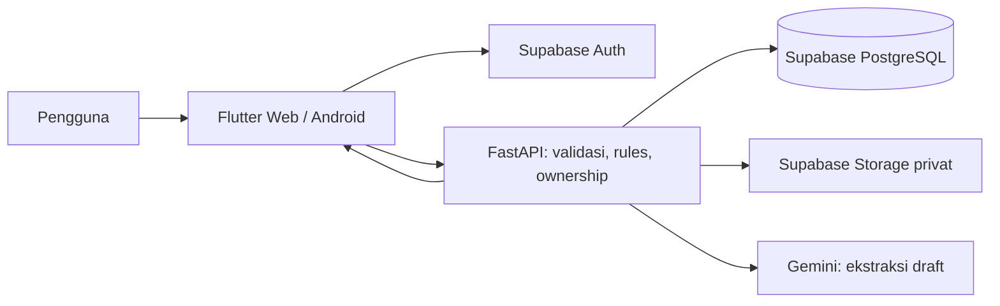

# AIBS

**Kategori:** Web dan Mobile (Android). **Nama tim resmi:** belum dikonfirmasi; lengkapi sesuai pendaftaran sebelum submission.

Pendamping menu dan jurnal makanan/gejala untuk orang dewasa, mengikuti arahan makan yang dilaporkan pengguna. LOGICODIX 2026 · Inclusive Health & Well-being.

**Bukan alat diagnosis atau penentu pemicu gejala.** Katalog, harga, profil demo dan aturan merupakan data sintetis. Hasil “Sesuai” dibatasi pada bahan dan arahan yang dikonfirmasi, bukan jaminan keamanan makanan.

## Coba demo

- [Aplikasi web](https://aibs-frontend.vercel.app) · [API/Swagger](https://aibs-gilt.vercel.app/docs) · [Readiness](https://aibs-gilt.vercel.app/ready).
- **Coba Demo → Manda, Nadia, atau Raka** membuat sesi anonymous privat; tidak membutuhkan OTP anggota tim.
- Manda, 23: **Mahasiswa KKI 26**, Low FODMAP, alergi udang, budget Rp25.000, dengan 14 hari riwayat makan/gejala sintetis untuk mencoba ringkasan.
- Nadia: Low FODMAP, alergi udang, budget Rp25.000. Raka: rendah lemak, alergi kacang tanah, budget Rp35.000. Katalog sama menghasilkan status/alasan berbeda.
- Aktifkan Bantuan AI di Profil → Privasi jika ingin mencoba foto/cerita. Manual tetap tersedia.
- F5 memulihkan sesi yang sama. Untuk login ulang sesudah logout, hubungkan email dan verifikasi kode dahulu. Memilih Nadia sesudah logout membuat sesi baru, bukan membuka akun bersama.

Production mengikuti deployment terakhir yang berhasil, sehingga dapat tertinggal dari `main` jika build gagal atau kuota deployment habis. Cocokkan commit sumber, deployment dan APK sebelum demo. Lihat [kesiapan demo](docs/hackathon-readiness.md) dan [skenario rekaman](docs/demo-script.md).

## Masalah, solusi, dan fitur

Target pengguna adalah orang dewasa yang membutuhkan bantuan memilih makanan mengikuti arahan makan yang mereka miliki, serta mencatat konsumsi dan gejala secara teratur. AIBS menyatukan pilihan menu, pemeriksaan bahan dan jurnal agar catatan dapat ditinjau kembali bersama tenaga kesehatan.

- Profil, alergi, preferensi, persetujuan AI dan pengecekan awal.
- Menu personal, cek bahan/porsi, saran pengganti bahan, rencana makan dan checklist belanja.
- Catatan makan manual, cerita atau foto dengan review sebelum simpan; catat ulang dari riwayat.
- Catatan gejala termasuk gas dan urgensi BAB, serta hubungan dengan catatan makan.
- Jurnal, grafik waktu makan dan gejala, ringkasan 7/30 hari dan ekspor CSV/PDF.
- Streak harian, mode gelap dan draft offline yang ditinjau sebelum dikirim saat online.

## Alur produk dan arsitektur

1. Login/demo → izin dasar dan AI terpisah → profil dan pengecekan awal berbasis aturan server.
2. Menu → alasan/bahan/porsi → koreksi dan cek ulang → rencana atau belanja. Keduanya bukan konsumsi.
3. Foto/cerita → draft → koreksi bahan, porsi, waktu dan negasi → konfirmasi → simpan satu transaksi.
4. Riwayat → detail/edit/hapus → Hari Ini dan ringkasan 7/30 hari diperbarui. “Belum tentu penyebab” tetap ditampilkan.

Flutter Android/Web memakai Supabase Auth untuk sesi dan FastAPI/Pydantic untuk fitur. Backend menangani rules, ranking, ownership, idempotency dan PostgreSQL. Gemini melalui backend hanya membuat draft; foto disimpan di Storage privat. Secret Gemini/service-role tidak masuk client. Alembic, RLS dan filter owner melindungi tabel aplikasi.

OCR dokumen, merchant, suara dan pengingat adalah pasca-MVP PRD. Ekspor ZIP dan PDF konsultasi sudah tersedia.



Alur AI: pengguna memberi izin dan mengirim cerita/foto -> backend meminta draft terstruktur -> pengguna mengoreksi bahan/waktu/porsi -> backend memeriksa dan menyimpan. Hubungan makan dan gejala bersifat deskriptif, bukan kesimpulan penyebab.

| Bagian | Teknologi dan layanan |
| --- | --- |
| Client | Flutter/Dart, flutter_svg, Supabase Flutter, http, image_picker, shared_preferences, pdf, share_plus, audioplayers |
| API | Python, FastAPI, Pydantic, SQLAlchemy, psycopg, Alembic, Uvicorn |
| Data dan sesi | Supabase Auth, PostgreSQL, Storage; RLS dan pembatasan pemilik |
| AI produk | Google Gemini melalui backend; model ditentukan `GEMINI_MODEL` |
| Build dan hosting | GitHub Actions, Vercel; Docker tersedia untuk backend |

## Struktur repository

```text
backend/       API, migrasi database, seed sintetis, dan tes
frontend/      Flutter Android/Web, aset aplikasi, panduan desain, dan tes
docs/          Kontrak API, setup layanan, panduan demo, dan bukti pengujian
scripts/       Pengujian integrasi browser
.github/       Workflow verifikasi dan build APK
```

## Setup lokal

Prasyarat: Git, Python 3.12/3.13, uv, Flutter 3.47.7 (Dart 3.13.5), Chrome; Android SDK/JDK untuk APK. Dependency dikunci di `backend/uv.lock` dan `frontend/pubspec.lock`.

```powershell
git clone https://github.com/danariqbalabi/AIBS.git
Set-Location AIBS/backend
uv sync --locked
Copy-Item .env.example .env
```

Isi database, Supabase dan key server langsung dalam `.env` yang diabaikan Git. Pertahankan `.env` yang sudah ada. Ikuti [backend README](backend/README.md), [Auth](docs/auth.md), [media](docs/media.md) dan [AI](docs/ai-integration.md).

```powershell
uv run python -m app.migrate
uv run alembic check
uv run uvicorn app.main:create_app --factory --reload --host 0.0.0.0 --port 8000
```

`app.migrate` menerapkan schema dan seed sintetis secara repeatable dari lingkungan release tepercaya; jangan menjalankannya dari request/preview build. Schema terbaru: `0003`, progres onboarding privat.

Buat `frontend/config/local.json` sesuai [frontend README](frontend/README.md). Client hanya memuat API_BASE_URL, SUPABASE_URL, SUPABASE_PUBLISHABLE_KEY dan opsional EMAIL_OTP_LENGTH (default 8; samakan dengan Supabase).

```powershell
Set-Location ../frontend
flutter pub get
flutter run -d chrome --web-port 5173 --dart-define-from-file=config/local.json
```

Pada Android, localhost mengacu ke perangkat; gunakan backend HTTPS dalam konfigurasi APK. Key publishable boleh di client, secret server tidak boleh. [Panduan Vercel](docs/vercel-deployment.md).

Konfigurasi lengkap backend tersedia di [`backend/.env.example`](backend/.env.example), client di [`frontend/config/example.json`](frontend/config/example.json).

| Lingkungan | Variabel | Kegunaan |
| --- | --- | --- |
| Backend | `DATABASE_URL`, `SUPABASE_URL`, `SUPABASE_SERVICE_ROLE_KEY` | Database, verifikasi sesi dan operasi server |
| Backend | `CORS_ORIGINS`, `APP_ENV`, `RUNTIME_MODE` | Origin client dan lingkungan eksekusi |
| Backend | `GEMINI_API_KEY`, `GEMINI_MODEL`, `AI_DAILY_LIMIT` | Ekstraksi draft AI dan batas penggunaan |
| Backend | `STORAGE_BUCKET`, `MAX_PHOTO_BYTES`, `CRON_SECRET` | Penyimpanan foto, ukuran upload dan cleanup terproteksi |
| Client | `API_BASE_URL`, `SUPABASE_URL`, `SUPABASE_PUBLISHABLE_KEY`, `EMAIL_OTP_LENGTH` | API HTTPS, sesi pengguna dan panjang OTP |

Untuk build Android lokal dari `frontend/`:

```powershell
flutter build apk --release --target-platform android-arm64 --dart-define-from-file=config/local.json
```

Hasil: `frontend/build/app/outputs/flutter-apk/app-release.apk`. Pindahkan ke Android ARM64 dan izinkan instalasi dari sumber tersebut jika diminta. Build demo memakai debug signing; belum untuk distribusi Play Store.

## Verifikasi dan APK

```powershell
# backend/
uv run ruff check .
uv run ruff format --check .
uv run pytest
# frontend/
dart format --output=none --set-exit-if-changed lib test
flutter analyze
flutter test --concurrency=1
```

[Actions](https://github.com/danariqbalabi/AIBS/actions) menjalankan PostgreSQL disposable dengan Python 3.12/3.13, pemeriksaan Flutter, web release dan APK ARM64. Artifact `aibs-android-demo` memuat APK, SHA-256 dan `build-info.json`; periksa `connected=true` dan commit. APK memakai debug signing untuk demo, bukan release toko aplikasi. Download artifact memerlukan login GitHub; tim perlu menyediakan tautan publik bagi juri.

Evaluasi NLP nyata memakai empat cerita sintetis, tanpa data pasien:

```powershell
# backend/
uv run python evaluate_ai.py --live --output ../docs/evidence/ai-nlp-evaluation.json
```

[Hasil evaluasi](docs/evidence/ai-nlp-evaluation.json) memuat model/prompt/token/latensi dan hasil per kasus. Ini bukan benchmark klinis, evaluasi semua foto, atau bukti Android fisik.

## Privasi dan batas demo

- AI hanya dipanggil ketika analisis diminta dan consent aktif. Review/edit/simpan/filter/ringkasan tidak memanggil model.
- Foto tanpa preferensi simpan dihapus setelah percobaan ekstraksi. Upload terbengkalai/cleanup gagal memiliki TTL akses 24 jam dan pembersihan cadangan.
- Hapus semua data menghapus data aplikasi/foto, bukan identitas Supabase Auth. Ekspor hanya milik pengguna.
- Pengujian Android fisik, foto makanan nyata yang beragam, OTP inbox, video final dan review klinisi/instrumen tetap perlu diverifikasi tim.
- `rome_v_c1_demo` adalah adaptasi kebutuhan demo, bukan instrumen resmi berlisensi. Tidak ada klaim efektivitas klinis. iOS belum menjadi target build.

## Tim dan submission

| Anggota | Tanggung jawab awal |
| --- | --- |
| Danar Iqbal Abi / [danariqbalabi](https://github.com/danariqbalabi) | Backend; kini integrasi full stack |
| Amanda Kwienisa | Frontend |
| Razan Muhammad | UI/UX |
| Micguel Katili | AI |

Ketua sesuai pendaftaran: **menunggu konfirmasi tim**. Video aplikasi berjalan 3–5 menit, APK publik, surat orisinalitas/atribusi dan commit final harus dilengkapi sebelum submission. Ikuti [checklist release](docs/hackathon-readiness.md).

## Penggunaan AI dan atribusi

Google Gemini digunakan untuk ekstraksi draft cerita/foto di backend, bukan diagnosis atau penentu akhir kesesuaian makanan. Model dipilih melalui `GEMINI_MODEL`; evaluasi sintetis yang disimpan menggunakan `gemini-3.5-flash-lite`. AI dapat dimatikan, dan alur manual tetap tersedia.

OpenAI Codex digunakan sebagai coding assistant untuk analisis, implementasi dan pengujian. Tim wajib meninjau dan mampu menjelaskan kode. Tidak memakai proyek aplikasi lengkap pihak lain. Nunito dibundel dengan [SIL Open Font License](frontend/assets/fonts/OFL.txt); ilustrasi dari handoff pengguna. Lisensi kode tim dan atribusi aset lain memerlukan keputusan pemilik.

Aset SVG/ilustrasi berasal dari handoff desain yang diberikan tim; salinan runtime berada di `frontend/assets/`. Bunyi UI dibuat secara prosedural melalui `frontend/tool/generate_sounds.dart`. Data menu, harga dan demo disediakan sebagai seed sintetis di `backend/seeds/` dan layanan demo; bukan dataset klinis. Framework, library dan versi dependensi dicatat dalam `frontend/pubspec.yaml`, `frontend/pubspec.lock`, `backend/pyproject.toml` dan `backend/uv.lock`.

Sumber kebutuhan: PRD, guidebook dan hi-fi pengguna, terpisah dari otorisasi tindakan pada layanan eksternal. [Kontrak API](docs/api/README.md) · [Integrasi FE–BE](docs/frontend-backend-integration.md) · [Riwayat pengerjaan](docs/app-completion.md).
