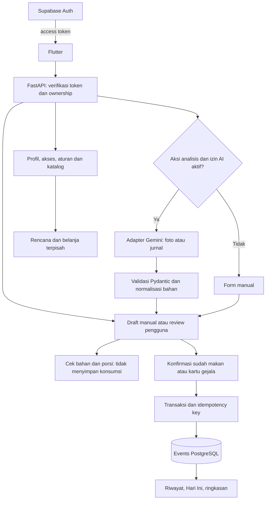

# Rancangan alur, data, dan API backend

**Status: baseline rancangan v0 sebelum implementasi.** Source/schema sekarang tersedia; [status aktual](backend-progress.md) dan [OpenAPI](api/openapi.json) menjadi acuan implementasi. Baca [pemetaan sumber/gap](backend-requirements.md); keputusan di bawah masih usulan jika berbeda dari source. Review FE/AI tetap diperlukan.

## Arsitektur dan batas layanan

Flutter memakai Supabase Auth untuk masuk/verifikasi kode. FastAPI memverifikasi access token, menentukan user dari identitas token (bukan `user_id` request), mengecek ownership/consent, lalu mengakses PostgreSQL dan Storage privat. Gemini hanya dipanggil melalui adapter server.

Usulan akses database: SQLAlchemy + psycopg dengan transaksi PostgreSQL; Alembic menjadi satu sumber migrasi. Jangan membagi satu transaksi simpan jurnal ke banyak panggilan REST database. Tentukan role koneksi dan kebijakan RLS secara eksplisit; koneksi server yang bypass RLS tetap wajib memfilter owner dan tidak boleh dipercaya aman karena ada policy client.



## Alur layanan

### Profil dan akses

1. Verifikasi JWT sesuai issuer/audience dan signing configuration proyek Supabase; expired/invalid ditolak. Jangan hanya decode payload atau menerima owner dari client.
2. Simpan consent dasar dan AI secara terpisah, termasuk versi kebijakan dan waktu. Data fitur memerlukan consent dasar; jalur akun/consent harus tetap bisa diakses sebelum onboarding selesai.
3. Simpan profil/assessment parsial untuk tombol Nanti. Nilai belum dijawab tidak dianggap tidak. Untuk pertanyaan tri-state, bedakan `yes`, `no`, `unknown`; nilai null berarti belum diisi.
4. Evaluasi routing lebih dulu, lalu aturan pola demo. Kembalikan `route`, `pattern_status`, alasan, field kurang, `allowed_actions` dan `rules_version`.
5. Update profil menaikkan `profile_version`. Semua evaluasi baru memakai versi terbaru; evaluasi yang akan disimpan dicek ulang bila versi berubah. Riwayat tetap menyimpan snapshot aturan/profil pada waktu pencatatan.

Usulan route: `out_of_scope`, `help`, `consultation`, `complete_answers`, `diet_support`, `logging_only`. Mapping detail red flags ke urgensi tetap memerlukan keputusan klinisi; jangan mengarang aturan tambahan dari gambar mock.

### Menu dan pengecekan

1. Normalisasi bahan ke ID katalog; nama ambigu menghasilkan pertanyaan, bukan tebakan.
2. Hitung konflik alergi, arahan dan batas porsi dari data yang diketahui. Simpan daftar alasan/konflik dan pertanyaan belum terjawab secara terpisah.
3. Keluarkan kandidat yang memiliki konflik keras dari daftar rekomendasi. Katalog lengkap boleh memperlihatkan menu tidak sesuai di kelompok terpisah seperti M1, dengan status jelas.
4. Urutkan kandidat yang layak berdasarkan kesesuaian budget/preferensi; gunakan tie-break ID stabil. Budget tidak boleh mengalahkan konflik alergi/arahan.
5. `POST /food-checks` tidak membuat food event. Bahan/porsi berubah -> hitung ulang tanpa AI. Jika diet_support tidak tersedia, jangan menghasilkan label kesesuaian diet yang belum berwenang dinilai; tampilkan keterbatasan/mode catat.

### Draft, konsumsi dan gejala

1. Buat draft `manual`, `photo` atau `journal`; simpan tujuan `before_meal`, `consumed` atau `journal`.
2. Analisis foto/jurnal memerlukan tindakan eksplisit, token valid dan izin AI aktif pada saat dispatch. Media harus milik user; client tidak boleh memberi URL bebas yang di-fetch server.
3. Validasi output AI: enum, field, limit ukuran, negasi, kandidat, dan ketidakpastian. Output tidak valid tidak menjadi catatan; beri error terstruktur yang membuka editor manual.
4. Simpan draft untuk melanjutkan nanti; edit draft tidak memanggil AI. Buang draft tidak menghapus event yang sudah tersimpan.
5. Saat commit, kunci/cek versi draft dan profil terkini. Makanan hanya disimpan setelah `consumed=true` dan waktu dikonfirmasi. Gejala bisa disimpan sendiri tanpa food event. Jangan melarang pencatatan makanan yang telanjur dimakan karena hasil ceknya buruk.
6. Simpan batch makanan/gejala, relasi, snapshot dan hasil idempotency dalam satu transaksi. Status `saved` hanya sesudah commit DB berhasil.

Idempotency: scope key ke `(owner_id, operation, key)`, simpan hash payload terkanonisasi dan response. Key sama + payload sama mengembalikan hasil yang sama; payload berbeda -> 409. Unique constraint dan lock transaksi harus menahan dua request bersamaan. Draft yang sama tidak boleh ter-commit dua kali dengan key berbeda; beri constraint batch per draft dan cek status di dalam transaksi. Kegagalan salah satu kartu me-roll back seluruh batch.

### Dashboard dan ringkasan

Query ulang data tersimpan setelah create/edit/delete, tanpa cache di MVP. FE melakukan refresh Hari Ini, riwayat dan ringkasan setelah mutation berhasil. Waktu disimpan timezone-aware (UTC), batas hari dihitung dari timezone profil, default demo `Asia/Jakarta`.

Hitung food events, gejala hadir (`present=true`), hari tercatat, informasi bahan yang belum jelas dan kelengkapan waktu. Negasi tidak menambah jumlah keluhan; tidak ada catatan tidak berarti bebas gejala. Keterkaitan makan/gejala hanya urutan waktu atau relasi yang dipilih, bukan sebab-akibat. Tampilkan catatan dasar untuk setiap hitungan. Threshold kelengkapan demo yang diusulkan ada di dokumen kebutuhan dan harus disepakati tim.

## Tiga jenis status yang berbeda

| Dimensi | Nilai usulan | Perlakuan FE |
| --- | --- | --- |
| Proses analisis | `processing`, `needs_confirmation`, `failed` | Loading, editor, retry/manual |
| Persistensi draft | `draft`, `saved`, `discarded` | Draft tidak dihitung sebagai catatan; saved sesudah transaksi |
| Hasil cek | `ok`, `warn`, `bad`, `unknown` | Mapping token design system + teks/simbol |

Hasil cek: `ok` = Sesuai (✓), `warn` = Perlu hati-hati (!), `bad` = Tidak sesuai arahan (×), `unknown` = Belum bisa dinilai (?). Jika ada konflik pasti sekaligus saus belum jelas, status utama `bad` tetap muncul, sementara `missing_information` juga dikirim. Unknown tidak boleh menyembunyikan konflik pasti. FE memakai warna dari design system, server mengirim kode/alasan dan data, bukan CSS.

## Model data usulan

Semua tabel privat memiliki owner yang berasal dari token, `created_at` dan `updated_at`. Katalog bersama read-only bagi user biasa. ID memakai UUID; nilai uang integer rupiah dan quantity decimal positif, bukan float uang.

| Tabel | Field / relasi penting |
| --- | --- |
| `profiles` | owner unik, display name, age band, diagnosis reported tri-state, clinician guidance, timezone, profile_version |
| `consents` | owner, basic/AI, granted, policy version, granted/revoked timestamp; riwayat perubahan |
| `assessments` | owner, jawaban parsial JSON tervalidasi, route, pattern status, rules_version |
| `diet_profiles` | owner, directive/fase; alergi, bahan dihindari, batas porsi, toleransi dan preferensi terpisah; budget rupiah |
| `ingredients`, `ingredient_aliases` | ID kanonis, alias, unit yang diizinkan, metadata dan sumber kurasi |
| `menus`, `menu_ingredients` | beli/masak, harga estimasi, porsi dasar, jumlah/satuan bahan, cara pesan/siapkan, sumber |
| `media` | owner, private storage path, MIME/ukuran, retention state; URL bertanda tangan tidak disimpan permanen |
| `drafts` | owner, source, intent, version, content schema JSON, status, media_id, profile_version |
| `record_batches` | owner, unique draft_id nullable untuk jalur langsung, waktu konfirmasi |
| `food_events` | owner, batch, consumed_at atau waktu perkiraan terstruktur, bahan/porsi terkonfirmasi, snapshot cek/profil |
| `symptom_events` | owner, batch, symptom code, present, severity nullable, onset/waktu perkiraan, konteks/BAB |
| `event_links` | food_event_id dan symptom_event_id owner sama; label urutan/tautan pengguna |
| `meal_plans` | owner, menu dan snapshot/modifikasi, scheduled_at; bukan food_event |
| `shopping_items` | owner, ingredient/custom name, quantity/unit, checked; gabung hanya ID dan satuan kompatibel |
| `idempotency_requests` | owner, operation, key unik, payload_hash, response/status; satu transaksi bersama record batch |
| `ai_runs` | owner, feature, model/prompt/schema version, status, latency, token counts; tanpa isi foto/jurnal/token auth di log |

Constraint penting: cross-owner FK ditolak (cek service + constraint relasi komposit bila sesuai), jumlah tidak negatif, versi optimistic locking untuk draft/profil, index `(owner_id, occurred_at)` pada event, dan unique idempotency. Delete food event menghapus relasinya, bukan symptom event terpisah; delete batch/all-data perlu aturan tersendiri.

Usulan seed: Nadia (21, Low FODMAP, alergi udang, budget 25000) dan Raka (24, rendah lemak, alergi kacang, budget 35000), sesuai hi-fi. Tiap sesi demo mendapat namespace/data privat sendiri; jangan berbagi dua akun writable untuk semua juri. Buat profil/katalog sintetis yang membuktikan konflik pasti dan perbedaan ranking; jangan menggunakan label mock sebagai bukti kesesuaian medis.

## Peta endpoint usulan

Prefix `/api/v1`. Semua endpoint fitur memerlukan Bearer token dan owner dari token; pengecualian hanya health, katalog profil demo publik yang tidak sensitif, serta pembuatan sesi demo terisolasi dengan rate limit. Login/OTP biasa langsung melalui Supabase Auth; tidak membuat auth buatan sendiri.

| Area | Method dan path | Hasil / ketentuan |
| --- | --- | --- |
| Operasional | `GET /health`, `GET /ready` | Liveness; readiness DB. Tidak membocorkan config/secret |
| Demo | `GET /demo/profiles`, `POST /demo/sessions` | Pilih template sintetis; buat sesi terisolasi via Auth, bukan owner bypass |
| Profil | `GET /me/profile`, `PATCH /me/profile` | Data/versi profil, akses dan allowed actions; version conflict -> 409 |
| Consent | `GET /me/consents`, `PUT /me/consents` | Basic/AI independen; cek ulang izin saat dispatch AI |
| Assessment | `GET /me/assessment`, `PATCH /me/assessment`, `POST /me/assessment/evaluate` | Autosave parsial lalu evaluasi deterministik |
| Katalog | `GET /ingredients`, `GET /menus`, `GET /menus/{id}` | Search/filter; menu menampilkan reasons, evaluated profile version |
| Rekomendasi | `GET /recommendations` | Hanya kandidat yang layak; gate akses server |
| Cek makanan | `POST /food-checks` | Bahan/porsi/versi profil; konflik + pertanyaan, tanpa consumption |
| Rencana | `GET /meal-plans`, `POST /meal-plans`, `PATCH /meal-plans/{id}`, `DELETE /meal-plans/{id}` | Jadwal terpisah; owner, timezone |
| Belanja | `GET /shopping-items`, `POST /shopping-items`, `PATCH /shopping-items/{id}`, `DELETE /shopping-items/{id}` | Qty/unit/checked; add dari menu boleh menyertakan menu ID dan porsi |
| Media | `POST /media`, `DELETE /media/{id}` | Upload multipart terbatas ukuran/MIME dan decode gambar, storage privat; hapus sesuai owner |
| Draft | `POST /drafts`, `GET /drafts`, `GET /drafts/{id}`, `PATCH /drafts/{id}`, `DELETE /drafts/{id}` | Source/intent/version; delete untuk draft yang belum committed |
| Foto | `POST /analysis/photo` | media_id + intent + analysis request ID -> draft review; cek consent/kuota |
| Cerita | `POST /analysis/journal` | text + reference date + timezone + analysis request ID -> draft review |
| Simpan batch | `POST /drafts/{id}/commit` | reviewed draft version + confirmed cards + Idempotency-Key -> record batch |
| Riwayat | `GET /events`, `GET /events/{id}`, `PATCH /events/{id}`, `DELETE /events/{id}` | Jenis food/symptom; filter periode/cursor; edit juga pakai versi |
| Hari Ini | `GET /dashboard?date=YYYY-MM-DD` | Mode, rencana, catatan tersimpan, hitungan gejala, state kosong |
| Ringkasan | `GET /summaries?days=7`, `GET /consultation-summary?days=7` | 7/30 hari, basis catatan dan keterbatasan, tanpa inferensi diagnosis/pemicu |

Untuk MVP analisis dapat synchronous dengan timeout terbatas: FE menampilkan loading selama request. Jika memakai async nanti, tambahkan job status endpoint/queue sungguhan; jangan mengembalikan job ID yang tidak bisa diambil hasilnya. Retry dengan analysis request ID yang sama jangan memanggil model dua kali; ini terpisah dari idempotency penyimpanan.

## Bentuk payload yang disepakati lebih dulu

- Waktu: `occurred_at` ISO-8601 ber-offset bila sudah pasti; jika masih perkiraan gunakan `time: {date, period, precision, confirmed}`. `siang`/`sore` tidak otomatis diberi jam pasti. Simpan waktu input server secara terpisah.
- Gejala: `{code, present, severity, time}`; `present=false` mempertahankan negasi, severity null. Daftar kode/intensitas/Bristol dan pilihan stres diselaraskan dengan editor hi-fi sebelum schema freeze.
- Bahan: `{ingredient_id, display_name, quantity, unit, certainty}`; ID/qty boleh null saat belum diketahui, certainty `candidate|confirmed|unknown`. Field hilang tidak dinormalisasi menjadi nol atau tidak ada bahan.
- Hasil cek: `{status, reasons: [{code, ingredient_id, message}], missing_information, profile_version, rules_version}`. Alasan singkat Bahasa Indonesia; tidak menyebut makanan aman mutlak.
- List: `{items, next_cursor}`. Pisahkan data kosong yang valid (200) dari gagal memuat.
- Error: `{error: {code, message, fields, retryable}, request_id}`. 401 token invalid, 403 consent/akses fitur, 404 resource tidak ada/milik akun lain, 409 versi/idempotency conflict, 422 input tidak valid, 429 rate limit/kuota, 502 invalid provider output, 503 provider unavailable/timeout. Manual tetap tersedia dari error AI.

Contoh fixture ada di [fixtures/backend](fixtures/backend). Fixture hanya untuk integrasi editor dan evaluasi; tidak membuktikan panggilan Gemini atau penyimpanan database.

## Struktur kode yang dituju

```text
backend/
  pyproject.toml + lockfile
  .env.example
  app/
    main.py
    core/           # config, auth, errors, logging
    api/v1/         # routes tipis
    schemas/        # request, response, AI structured output
    models/         # database
    repositories/   # owner-scoped queries
    services/       # profile, assessment, catalog, draft, records, summary
    rules/          # deterministic assessment dan food check
    integrations/   # supabase storage, adapter AI
  alembic/          # migrasi versioned
  seeds/            # katalog dan profil sintetis + sumber
  tests/            # aturan, transaksi/concurrency, ownership, integrasi
docs/
  backend-requirements.md
  backend-design.md
  backend-workflow.md
  fixtures/backend/
```

Tidak perlu microservice, queue, training model, atau AI untuk dashboard dalam MVP ini. Detail package/runtime diverifikasi dan dipin saat bootstrap, bukan diklaim sudah tersedia oleh rencana.
